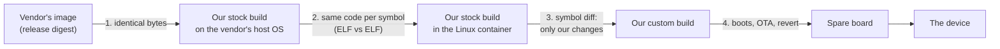

# Chain of trust: from a vendor's image to your own

The goal: never flash a self-built WLED image unless every byte that differs from a known-good
image is explained. The known-good image is the vendor's published build (for example QuinLED's
board-specific WLED releases), which is what the device already runs.

1. **Stock build = vendor's image, byte for byte** (sha256). This proves the inputs: WLED commit,
   build flags, usermod commits, library versions, toolchain, UI build time. When it isn't identical,
   `studio/imgdiff.py` classifies every differing byte, and anything unexplained fails.
2. **Container build ≡ the step-1 build**, compared per symbol (`studio/elfdiff.py`). Allowed
   differences: toolchain host strings, and addresses that shift after them.
3. **Custom build vs stock build**, both from the container: the symbols differ only by your
   usermod (and by any built-in effects you chose to remove).
4. **A spare board** of the same chip family boots it, survives an OTA and an `/update?revert`, and
   passes post-flash checks (version, usermods, free heap, frame rate). Only then the device.

Each new vendor release reruns step 1 against the vendor's new image.

## What can differ, and why

| Source | Where it shows | Handling |
|---|---|---|
| UI build time (`WEB_BUILD_TIME`) | 4 bytes | Pinned per build (`web_build_time`) |
| Toolchain host (newlib paths) | strings, and everything after them | Build on the vendor's host OS for step 1 |
| Toolchain binary per host architecture | code generation, if the compiler isn't host-independent | Recorded; compared in step 2 |
| Line endings (Git for Windows: `autocrlf=true`) | the gzipped web UI | `build.py --autocrlf` |
| Floating usermods and libraries | anywhere | Pinned by commit in the pins file |
